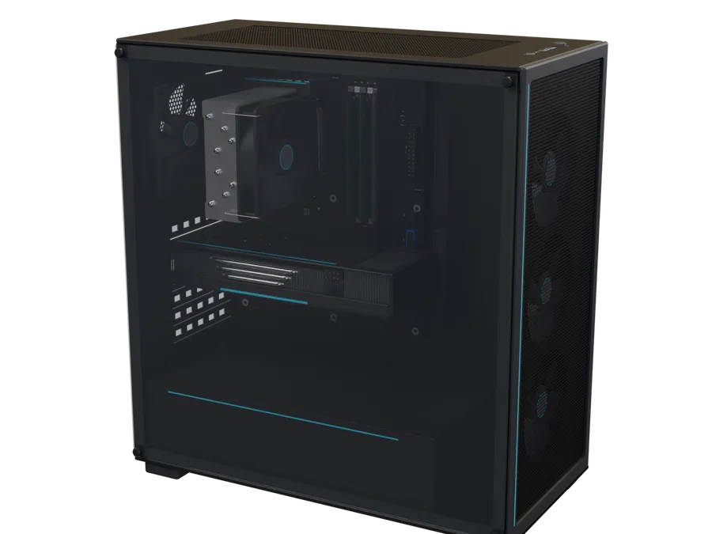

# Monter son PC de A à Z : guide 3D interactif

👉 **[Voir le site en ligne](https://wissemm697.github.io/pc-builder/)**

Un site en **français et en anglais**, avec de la 3D interactive, qui explique **de A à Z** comment choisir et monter un PC fixe de **milieu de gamme** (boîtier moyen tour ATX). Il est écrit pour un débutant : chaque terme technique est expliqué la première fois qu'il apparaît, et on peut le survoler pour revoir sa définition.



*English version: [`en/`](en/). The site is available in French and English, with a language menu in the top-right corner.*

## Lancer le site (une commande)

Dans un terminal ouvert dans le dossier `pc-builder` :

```bash
python serve.py
```

Le navigateur s'ouvre tout seul sur **http://localhost:8000**. Sous Windows, si la commande `python` n'est pas reconnue, tape `py serve.py`. Pour arrêter, fais **Ctrl+C**.

Il n'y a **rien à installer** à part Python (3.8 ou plus récent). Three.js est déjà inclus dans le projet, donc le site marche même sans Internet.

D'autres façons de le lancer :

| Commande | Quand l'utiliser |
|---|---|
| `python serve.py --lan` | Pour ouvrir le site depuis un téléphone ou une tablette sur le même Wi-Fi. L'adresse à taper s'affiche dans le terminal. |
| `python serve.py 8080` | Si le port 8000 est déjà pris. Le script essaie aussi les ports suivants tout seul. |
| `npx --yes http-server -p 8000 -c-1` | Si tu préfères Node.js (raccourci : `npm start`). |

> **Pourquoi ne pas double-cliquer sur `index.html` ?** Le site charge des modules JavaScript et des modèles `.glb`. Pour des raisons de sécurité, les navigateurs bloquent ces chargements quand une page est ouverte depuis le disque (adresse `file://`). Il faut donc passer par un petit serveur local (adresse `http://`). C'est le rôle de `serve.py`.

## Ce que contient le site

1. **Accueil** : le PC assemblé tourne en 3D, avec le bouton « Commencer ».
2. **Vue d'ensemble** : l'analogie de la cuisine de restaurant (le CPU est le chef, la RAM le plan de travail, le stockage le frigo…) et le trajet d'un programme, du stockage jusqu'à l'écran.
3. **Les 8 pièces**, dans l'ordre : processeur, carte mère, RAM, stockage, carte graphique, alimentation, refroidissement, boîtier. Chaque fiche contient :
   - une visionneuse 3D (rotation et zoom à la souris ou au doigt, repères cliquables) ;
   - le rôle de la pièce, avec une analogie ;
   - « Comment lire sa fiche technique » ;
   - des ordres de grandeur ;
   - un encadré « Compatibilité » et un encadré « Erreurs de débutant ».
4. **Vue éclatée** : un curseur fait passer de « éclaté » à « assemblé ». Au survol, la pièce s'éclaire et son nom s'affiche ; un clic emmène à sa fiche.
5. **Montage pas à pas** : 11 étapes animées en 3D (préparation, processeur, RAM, SSD, ventirad, carte mère dans le boîtier, alimentation, câbles, carte graphique, rangement des câbles, premier démarrage).
6. **BIOS/UEFI** : un faux écran de BIOS manipulable (vérification des pièces, EXPO/XMP, ordre de démarrage), puis l'installation du système depuis une clé USB.
7. **Périphériques et connectique** : écran, clavier, souris, schémas des prises USB-A, USB-C, HDMI, DisplayPort et Thunderbolt, et un tableau « lequel utiliser pour quoi ».
8. **Checklist de compatibilité** : 6 vérifications à cocher, plus un calculateur de puissance d'alimentation. Les cases cochées sont mémorisées par le navigateur.
9. **Glossaire** : 82 termes, avec une recherche.

Avant le montage, une section **« La sécurité d'abord »** explique l'électricité statique et les précautions électriques. Des rappels apparaissent aussi aux étapes sensibles.

En haut à droite :
- **le menu des langues** (🌐 FR / EN) : le choix est mémorisé. Lors d'une première visite, un navigateur qui n'est pas réglé en français arrive sur la version anglaise ;
- **le bouton clair/sombre** : par défaut, le site suit le réglage de l'ordinateur ou du téléphone.

## Structure du projet

```
pc-builder/
├── index.html                 le site en français (texte, sections, schémas SVG)
├── en/index.html              le même site en anglais
├── serve.py                   serveur local (une commande)
├── css/style.css              thèmes clair et sombre, mise en page responsive
├── js/
│   ├── main.js                démarrage : branche chaque visionneuse et chaque module d'interface
│   ├── prefs.js               thème et langue préférés, appliqués avant l'affichage
│   ├── i18n.js                textes affichés par le JavaScript, en français et en anglais
│   ├── core/                  briques 3D partagées
│   │   ├── loader.js            chargement unique de chaque .glb, puis clonage
│   │   ├── fallbacks.js         modèles simplifiés de secours si un .glb ne charge pas
│   │   ├── stage.js             scène, lumières, ombres douces, caméra, cadrage automatique
│   │   ├── viewport-manager.js  allume et éteint les visionneuses selon le défilement
│   │   ├── pc-rig.js            assemble les 9 modèles grâce aux ancres
│   │   ├── cables.js            câbles animés (posés en vrac puis rangés)
│   │   └── anim.js              petites animations (tweens)
│   ├── views/                 un module par type de vue
│   │   ├── hero-view.js         PC qui tourne sur l'accueil
│   │   ├── part-viewer.js       visionneuse d'une pièce
│   │   ├── exploded-view.js     vue éclatée
│   │   └── assembly-view.js     montage pas à pas (11 étapes)
│   ├── ui/                    navigation, langue et thème, infobulles, glossaire, BIOS, checklist, graphiques
│   ├── data/
│   │   ├── parts.js             réglages des visionneuses (vues, repères, boutons)
│   │   └── manifest.js          ancres et pivots des modèles (généré automatiquement)
│   └── vendor/three/          three.js 0.160.0 (version figée)
├── models/                    les 9 modèles .glb compressés (1,2 Mo au total)
├── img/                       favicon et aperçus des modèles (WebP)
├── scripts/
│   ├── blender/               scripts Python qui génèrent les modèles
│   │   ├── common.py            outils partagés : formes, matériaux, textures, export, rendu
│   │   ├── layout.py            toutes les cotes (en cm) partagées entre les modèles
│   │   ├── model_*.py           un script par pièce
│   │   ├── build_all.py         génère tous les modèles d'un coup
│   │   └── render_assembly.py   rendu du PC assemblé (image d'accueil)
│   ├── optimize-models.mjs    compression des modèles, manifeste et aperçus
│   └── update-csp.py          met à jour la politique de sécurité des pages
├── package.json               outils de compression (seulement pour régénérer les modèles)
├── CREDITS.md                 origine et licence de chaque ressource
├── SECURITY.md                sécurité du site et signalement d'un problème
├── LICENSE                    licence MIT
└── README.md
```

## Régénérer les modèles 3D

Tu n'en as **pas besoin** pour utiliser le site : les modèles finis sont déjà dans `models/`. Cette partie sert si tu modifies un script Blender.

### 1. Générer les modèles bruts avec Blender

Avec **Blender 5.x** installé (testé avec la 5.2) :

```bash
blender -b -P scripts/blender/build_all.py                  # les 9 modèles et leurs aperçus PNG (quelques minutes)
blender -b -P scripts/blender/build_all.py -- --no-render   # sans les aperçus (bien plus rapide)
blender -b -P scripts/blender/build_all.py -- gpu psu       # seulement certaines pièces
blender -b -P scripts/blender/model_gpu.py                  # une seule pièce
```

Sans installer Blender, le module Python officiel `bpy` fait la même chose. Il lui faut **Python 3.13** :

```bash
pip install bpy==5.2.2
python scripts/blender/build_all.py --no-render
```

Les fichiers bruts vont dans `.build/` (ce dossier n'est pas livré) : `raw/` pour les .glb, `previews/` pour les aperçus PNG, `manifest/` pour les ancres et `textures/` pour les textures générées.

Options de contrôle utiles pendant la mise au point (après `--` avec `blender`) :

- `--quick` : aperçu basse qualité ;
- `--view x,y,z` : autre point de vue ;
- `--target x,y,z --radius r` : zoom sur une zone, en cm.

### 2. Compresser et mettre à jour le site

Il faut **Node.js 20 ou plus récent** :

```bash
npm install
npm run optimize
```

Ce script compresse chaque modèle (meshopt, textures WebP de 1024 px au maximum) dans `models/`. Il régénère aussi `js/data/manifest.js` et les aperçus `img/previews/*.webp`, puis affiche la taille de chaque fichier. Il prévient si un modèle dépasse 3 Mo ou si le total dépasse 30 Mo.

L'image d'accueil (le PC assemblé) se refait avec `blender -b -P scripts/blender/render_assembly.py`, suivi de `npm run optimize` pour la convertir en WebP.

## Conventions des modèles

Ces règles permettent aux modèles de s'emboîter sans réglage à la main.

- **Unités** : les scripts travaillent en centimètres, et les dimensions sont les vraies. Le boîtier fait environ 45 × 22 × 48 cm, la carte mère ATX 30,5 × 24,4 cm, la carte graphique 28 cm de long. À l'export, Blender passe en mètres (convention glTF), puis le site remet tout à l'échelle (1 unité = 1 cm).
- **Axes** (côté site) : +X vers l'avant du boîtier, +Y vers le haut, +Z vers la vitre, donc vers la personne qui regarde.
- **Position de montage** : chaque pièce est modélisée dans l'orientation qu'elle a une fois montée. Par exemple, la carte graphique est à l'horizontale, ventilateurs vers le bas.
- **Ancres** : ce sont des objets vides nommés `anchor_*`. Ils marquent où une autre pièce vient se fixer, par exemple `anchor_cpu`, `anchor_cooler`, `anchor_ram_A2`, `anchor_ram_B2`, `anchor_m2_1`, `anchor_pcie_x16` sur la carte mère, et `anchor_motherboard`, `anchor_psu`, `anchor_fan_front_1/2/3`, `anchor_fan_rear` sur le boîtier. Les cotes communes sont dans `scripts/blender/layout.py`.
- **Pièces mobiles** : levier du socket, loquets de RAM, vitre, caches de slots, vis… Ce sont des objets séparés, avec leur pivot noté dans le manifeste, pour pouvoir les animer. Les hélices portent `spinAxis` et `spinDir` dans leurs `extras` glTF.
- **Matériaux** : rendu physique (PBR) avec une palette commune dans `common.py`. La vitre est le seul matériau transparent.

## Comment fonctionne le code

- **Une visionneuse ne démarre que lorsqu'elle approche de l'écran.** Elle s'arrête quand on s'en éloigne, et son contexte WebGL est libéré au bout de 45 s. Les navigateurs limitent le nombre de contextes WebGL ouverts en même temps. Au-delà de 5 visionneuses actives (3 sur mobile), le site libère d'abord celles qui sont hors écran depuis le plus longtemps.
- **Chaque modèle est téléchargé une seule fois**, puis cloné pour toutes les vues qui l'utilisent.
- **Le site ne casse jamais** : si un modèle ne se charge pas, une version simplifiée construite directement en Three.js prend sa place. Si WebGL n'est pas disponible, chaque visionneuse affiche son image d'aperçu.
- **Accessibilité** : navigation au clavier, termes du glossaire accessibles avec Tab, réglage « réduire les animations » du système respecté.
- **Deux langues** : chaque langue a sa propre page HTML (`index.html`, `en/index.html`), avec les mêmes identifiants de sections. Les rares textes créés par le JavaScript sont dans `js/i18n.js` et `js/data/parts.js`. Pour ajouter une langue, suis la marche à suivre en tête de `js/i18n.js`.
- **Sécurité** : chaque page n'a le droit de charger que les fichiers du site (politique CSP). Si tu modifies l'importmap d'une page, lance `python scripts/update-csp.py`. Détails dans `SECURITY.md`.

## Tests effectués

Le site a été vérifié dans Chromium en mode automatique (Playwright), sur ordinateur (1440 × 900) et sur mobile (390 × 844). Les points contrôlés :

- toutes les sections s'affichent et les 9 modèles se chargent ;
- les 11 visionneuses démarrent, sans aucune erreur ni aucun avertissement dans la console ;
- la vue éclatée marche : curseur, survol, clic vers la fiche ;
- les 11 étapes du montage se jouent, en avant comme en arrière ;
- le BIOS, la checklist, le calculateur, le glossaire et les infobulles fonctionnent ;
- si un fichier `.glb` est bloqué, le modèle simplifié prend sa place et tout le reste continue de marcher ;
- dans un navigateur sans WebGL, les images d'aperçu s'affichent avec un message, et le texte comme les outils restent utilisables ;
- les deux langues, les thèmes clair et sombre, le menu des langues (choix mémorisé) et la politique de sécurité (aucune ressource bloquée).

Le test automatique utilise un rendu logiciel, donc très lent (2 à 3 images par seconde). Sur un vrai ordinateur, avec une carte graphique, les animations sont fluides.

## Contenu

Le contenu porte sur du matériel grand public récent : sockets AM5 et LGA 1851, DDR5, SSD NVMe, alimentations ATX 3.x. Il évite volontairement les références de modèles et les prix, qui changent tout le temps. Quand un chiffre varie trop d'un produit à l'autre, le site donne un ordre de grandeur plutôt qu'une valeur précise.

## Licence

Le code et les modèles 3D sont des créations originales de ce projet, sous licence MIT (voir `LICENSE`). Les ressources tierces et leurs licences sont listées dans `CREDITS.md`.
